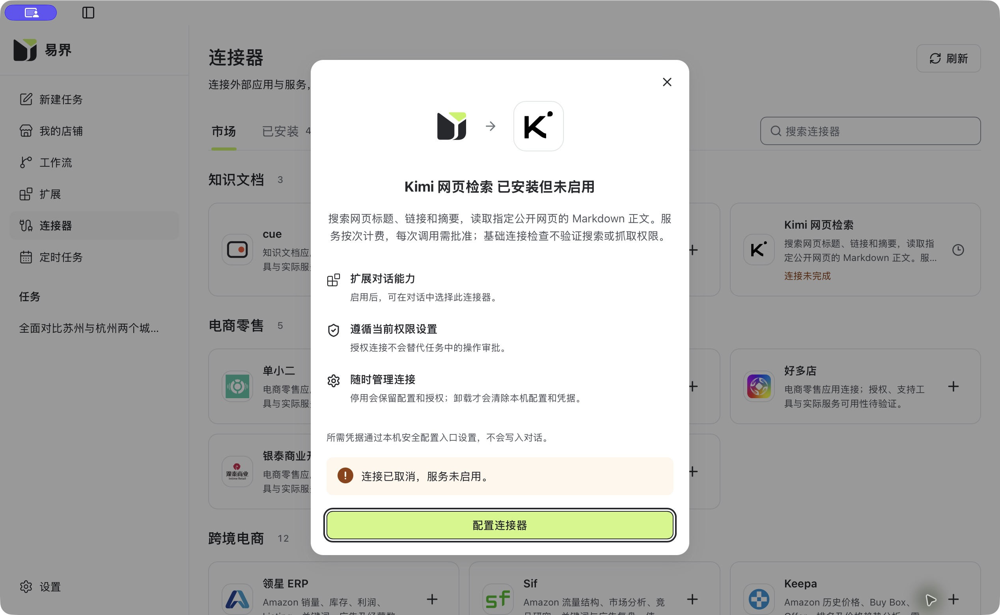

# FEAT-162 验证记录

> 当前状态（2026-10-29）：第八代E1仍失败，累计3次模型HTTP、0REST、3元未知用量估算；Owner已暂停构建与收费验收，方案A清理完成。现已另行授权全仓Git提交/推送；完整当前状态见[34号](34-paused-state-and-cleanup.md)。下文授权与执行进度按历史时点理解。

## 2026-10-29 当前：软预算、精确来源与真实App执行

Owner已明确20元为软停止阈值，允许在途超出后停止，不要求费用硬上界；仅本地提交FEAT-162已批准，不推送。当前v3计量、来源提交和App/Workflow进展见[33号](33-real-app-execution.md)，授权见[evidence/current-authorization-20261029.json](evidence/current-authorization-20261029.json)。真实七例及D4仍待执行。下列历史收费、提交与准入限制按其原时点解释。

## 2026-10-29 — 全量生成与停止适配续验

完整生成/检查及Workflow检查通过，43项Contracts、8项v2计量、19项legacy计量、7项Owner适配、1项配置、1项Native环境检查通过。准确App→Host→worker撤权尚未资格化；本轮已获20元授权但实际付费0，E1—E7 NOT RUN、D4未通过。细节与修复中失败日志见29/30及evidence/next-checks-20261029.json。

以下为历史记录，旧“当前/最新/未授权”按原时点理解。

## 2026-10-29 最新：兼容阻塞修复与补充检查

原5项EOF已关闭，九个完整基线PASS；Contracts38、Kimi27、Host正规worker生命周期5（含2子例）、Desktop44项通过。Contracts lint/worker lint/前端lint通过；有界组件亮暗1180×760、键盘和axe证据见[eof-component-ui](evidence/eof-component-ui-20261029.json)。整体结果见[26号](26-offline-compatibility-and-zero-cost-followup.md)及[27号复审](27-offline-compatibility-reaudit.md)。

额外旧全量生成检查FAIL_BASELINE，副作用已安全恢复；不把九基线通过写成全部生成门禁通过。真实App/历史重开、native费用硬界与owner停止链、E1—E7仍NOT RUN，付费0，D4未通过。24/25的“5项EOF”是本次修复前记录，原日志保留。

## 2026-10-29 最新实施验证

本轮契约/代码与可执行零费用检查已完成；[24号](24-basic-pro-implementation-and-zero-cost.md)记录完整范围及Z组部分覆盖，[25号](25-implementation-reaudit.md)记录最终复审。命令、退出码、日志摘要及保护检查见[机器证据](evidence/implementation-checks-20261029.json)。

最终Contracts Node33、Rust web5/broker6；Connectors24；Desktop focused28（此前更宽44）；Native observe4；Host两项race；新meter6/旧19/纯配置1项通过。来源/格式/静态检查、worker正规新generation、前端和设计构建通过。完整breaking8个基线中3通过、5因既有远程schema EOF未完成，不能宣称契约全绿。

真实E1—E7、accurate App激活、亮暗/1180×760及新历史正常重开NOT RUN。v2 live因native硬费用界限和owner停止链未资格化固定拒绝；实际付费0。AC-021—030仍pending、D4不通过；旧20号FAIL及三份未知占用保留。以下“全部产品NOT RUN/只改文档”只描述先前轮次。

## 2026-10-29 当前修订验证边界

当前需求以00、22、23及feature.yaml为准。五项缺口及E5已补为明确设计决策；implementation=pending，新AC-021—030仍全pending，Z1—Z10与E1—E7产品验证全部NOT RUN。旧20号真实客户端FAIL与三项未知预占保持，不用文档通过覆盖。

| 检查层次 | 当前含义 |
|---|---|
| 本轮文档检查 | 严格D0、元仓lint、57项治理测试和7脚本语法检查通过；最终一致性/保护见evidence/requirements-reaudit-checks-20261029.json，不证明代码实现 |
| 三项并行复审 | 分别审期限/计量、契约/结果、产品/验收/预算；是Codex子代理审阅，不是独立人工批准 |
| Z1—Z10 | 未来普通值/loopback/实际消费者的产品验证，当前NOT RUN |
| E1—E7 | 未来同源真实工具集合下的7会话/8用户回合，当前NOT RUN；限17模型/各REST工具3次 |
| 收费准入 | NOT RUN；无新授权，实际模型费用上界、原生搜索硬上界和等价入口尚未证明 |
| 历史失败 | 20号模型4次/Basic0/Fetch0及42.710457元保守占用原样保留 |

当前REST部分上界0.105元；完整新预算为模型上界之和+0.105+R_native，241.421224仅旧单次模型上界适用时的条件小计。未访问Key/账户、未启动服务或应用，未运行攻击/故障注入、强杀、权限破坏或二进制替换。未执行项目及影响：跨仓源生成/产品测试/构建/真实调用均因用户限定只改需求而未执行，不能证明运行正确性、时延或实际费用。

以下为历史验证，2026-10-28的五用例/11模型和旧D0仅对当时版本有效。

## 2026-10-28 Basic/Pro扩展当前验证状态

当前需求：00、21、22及feature.yaml。产品实现pending；新AC-021至030全部pending；Pro和Basic正文真实验收NOT RUN。旧20号客户端验收FAIL保留（模型4、Basic0、Fetch0），不能被本轮文档检查覆盖。

本轮已通过需求包结构、严格D0、元仓lint、57项治理测试及7个脚本语法检查，均退出0。文档链接/AC一致性与保护范围另有最终核对；实际命令、退出码与产物见evidence/basic-pro-requirements-checks-20261028.json。文档D0结果不等于产品D4或新的执行授权。

| 产品验证组 | 当前结果 | 计划证据 |
|---|---|---|
| 源契约/方向兼容/来源同步 | NOT RUN | AC-022，旧0.2基线与新候选 |
| Basic两模式、Pro筛选/chunks、Fetch | NOT RUN | AC-024/025，普通响应与E1—E4 |
| 模型选择与混合任务 | NOT RUN | AC-023，E1/E2/E3/E5实际tool call |
| 拒绝/过期/期限/错误/大小/计费 | NOT RUN | AC-026/027/028，零费用普通检查及受限实际运行 |
| 拟交付App/UI与成功历史重开 | NOT RUN | AC-021/029，实际入口、来源回执与0重放 |
| 新完整真实验收 | NOT RUN | AC-030，E1—E5及单独批准的预算 |

未实施任何产品检查或收费测试；没有使用攻击fixture、强杀、权限故障或可执行替换。旧报告中的PASS/FAIL及截图均为对应历史来源，下面原文继续保留；不能作为新增Pro能力的证明。

保护检查说明：第一次断言所有兄弟仓工作树保持不变时失败，实际是Contracts/Host/Desktop出现与FEAT-165相关的并行dirty。没有回滚这些改动。最终分别核对本轮范围、旧文件、历史快照、关闭台账和仓库HEAD，并记录外部工作区差异，不将整仓不变宣称为PASS。

> 后续变更：用户已授权复用现有Kimi模型Key；此前独立Keyring配置要求已由`05-model-key-reuse-plan.md`与`06-model-key-reuse-verification.md`替代。以下保留原轮次证据。

**用户恢复后，本轮启动修复和无收费调用的连接器界面验收已完成。** Host 专家资源摘要遗漏已正规同步，实际 App 启动、目录、安装、空密钥配置取消、禁用选择和同构建重开均通过。真实账户 Search/Fetch、模型驱动 MCP 与整体 D4 仍为 **NOT RUN**，遵守用户“真实收费 API 先不要执行”。当前证据见 `evidence/app-resume-ui.json`；下文保留修复前历史，恢复结果以最后一节为准。

## 验证边界

- 使用正常、非破坏性验证；禁止强杀、可执行替换、权限故障、攻击fixture和攻击注入。
- 真实Search/Fetch/模型调用尚未获得本任务额度，不继承旧Feature额度。
- 付费与凭据阶段前先完成可审查实现、focused验证和标准构建。
- 每项记录命令、实际退出码、产物和适用范围；不将本地协议/基础连接验证称为真实业务PASS。

## 实现边界

- 完整方案先于产品代码落盘并通过 D0，见 `evidence/plan-before-implementation.json`。
- 用户授权目录上限增加 2：reader 从 60 扩到 62，实际目录 61。一个 `kimi-web` 连接器提供 `kimi_web_search`、`kimi_web_fetch` 两个工具，单轮选择上限 58 不变。
- Search 输出标题、URL、摘要；Fetch 输出指定 URL 的标题和 Markdown 正文。没有无头浏览器、JavaScript 渲染或原始 HTML 功能。
- 复用原 Broker/Gateway、Keyring、选集、租约、逐次审批与 MCP 结果链路。没有重建 Agent 循环或修改 Codex 内核。
- `yijie-codex` HEAD 仍为 `9154f27d0cdb526a5f5ba0913fe3e2448014b4a1`，工作区干净；已有原生搜索保留。已有其他需求修改未回滚。

## 定向检查

| 范围 | 实际结果 | 证据 |
| --- | --- | --- |
| Contracts | 41 JS、5 Go 包、Rust web 4 / market 7 / host 7、lint、定向 Clippy、生成与同步检查通过；接受 60/61/62 并拒绝 63 | `evidence/contracts-verification-summary.json` |
| Connectors | `make worker-test-kimi` 13/13；5 项普通既有回归、Go catalog/internalapp 两包 race、`make worker-lint`、diff 检查通过 | Connectors `docs/kimi-web-retrieval.md`、`evidence/independent-code-review.json` |
| Host | 四包普通命名 allowlist race、marketbroker 与生成包 vet 通过 | `evidence/host-focused-checks.json` |
| Desktop | 5 个前端文件 47/47、Native 11/11、契约消费检查、ESLint、vue-tsc、fmt、Clippy、Vite 和设计文档构建通过 | `evidence/desktop-focused-checks.json` |
| 真正 worker 子进程 | canonical 构建成功；正常 control lifecycle、非空未资格化与 EOF、新线程准备、复用单子进程共 4 项通过 | `evidence/worker-build-and-owner.json` |
| 专家资源来源传递 | 11 个生成业务输出字节不变；canonical producer 刷新来源，全部 75 归档 metadata/bytes 与授权、审查保持一致；6 项普通 Node 检查、ESLint、原 `--check` 通过 | `evidence/contracts-transitive-qualification-summary.json`、`evidence/expert-provenance-refresh.json` |
| 元仓 | D0 与 lint 通过；最终 `pnpm test` 50/50 | `evidence/meta-checks.json` |

HTTP 普通成功检查使用正常 loopback 服务，计数为一次请求后正常关闭。取消、参数和容量检查使用非攻击性纯函数/正常生命周期路径；未故障注入、强杀进程、替换可执行文件、破坏权限或注入攻击 fixture。

## 独立审查与修复

1. 底层原 HTTP client 的默认协议重试可能绕过一次请求许可。修订先写入方案第 11 节，再在 Connectors 使用锁内同版 `reqwest=0.12.28`，显式禁止重试与重定向，整体绝对期限覆盖流式响应；876 个外部依赖记录不变。独立复审关闭 P1。
2. 来源刷新重构曾把 `--package` 的完整 pin/schema preflight 移到 producer 之后；已恢复原有先检查后生成顺序。最终脚本 SHA256 `e087d9bffa7db53a2ee5e3a4cd30298ccfd86f439612eb093985935306c73b28`，独立只读复审确认关闭。

## 标准构建与界面

- 最终 canonical worker SHA256：`1f35e4ab2d392dab59383f2951c495117f001ededfa97150b6f78c5bf0a10745`，84,680,688 bytes；`current.json` 为 `candidateOnly: true`、`qualificationOnly: false`，不是发布产物。
- 原 App 通过 Cmd-Q 正常退出，进程检查确认其 Desktop/Host/worker/artifact 子进程均结束。
- 首两次候选 freeze 依次发现间接专家来源锁、专家资源 pin 需要更新，均由正规生成/打包链解决，没有手改哈希绕过校验。随后 freeze 通过。
- 首次 App 编译/打包通过，但源码在审查修复时改变，标准 receipt 正确拒绝“Desktop build inputs changed during build”，未启动 App。待最终源码固定后重新运行相同 canonical 入口，不复用无效回执。
- 最终 `YIJIE_FEAT156_LOCAL_CANDIDATE=true pnpm tauri:demo-fast:app` 构建、打包和来源回执通过，App PID 64599 输出正常窗口诊断；回执 SHA256 `5569f56de59cde96626319ab7b53a4f9ce51473f4abf9b90eb25145d75e62a08`，详细二进制摘要见 `evidence/app-build-ui.json`。
- CUA 最初报告 Mac 锁屏；用户回复后界面可读。首页显示本地服务未就绪，点击一次正常重试仍未恢复；连接器页显示服务暂不可用。最后进程观察只有 Desktop，没有 Host/worker 子进程。根因未定位，用户已要求暂停；市场安装、配置页取消和同构建正常重开均为 NOT RUN。

## 保留的失败、警告与未执行项

- 7 个完整 breaking 基线：3 个通过，4 个受已有 `scheduled-plan-draft` 远程 `$ref` EOF 影响退出 102。完整基线不能声称全绿，原日志保留。
- 专家补充检查 34 项通过、1 项失败：旧隔离断言仍比较 market-host schema 与 `35e0949c95` 基线。已确认早于本需求，不修改或弱化该检查。
- 首次元仓测试 48/50：并行 FEAT-163 目录尚未有 feature.yaml；其文件形成后重跑为 50/50，没有修改该需求。首次在父目录执行 lint 的路径错误已记录并纠正。
- 设计/Vite 构建保留已有超过 500 kB chunk 警告；Contracts lint 有 12 项既有 Redocly 警告。
- formatter 原 socket stdin 检查曾等待 EOF。改用真实 formatter 读取正规临时文件，7 项生成结果 SHA 一致且新检查完成；旧 `rustfmt` PID 10952 无可用正常退出通路，保留 **STOP_PENDING**，未强杀。只读采样显示等待标准输入，没有运行供应商调用。
- 本任务真实 Kimi 凭据保存、`/models` probe、Search/Fetch、模型回合和真实审批拒绝：**NOT RUN**，收费调用为 0。需要用户在安全页面配置独立连接器密钥并给出本任务真实测试额度；不能继承旧 Feature 授权。
- 未运行含攻击注入、权限故障或强杀的历史整套测试；影响是这些异常路径没有本任务动态验收证据，不能伪称通过。
- 没有提交、推送、生产部署或公开发布。所有更新为本地候选 `release: false`。

## 待授权的最小真实验收

用户完成安全 Keyring 配置后，进行 Search 一次（公开官方资料查询）、Fetch 一次（公开官方文档 URL）、正常拒绝一次工具审批（应零业务请求），然后正常重开同一构建核对历史。模型驱动另需最多两个用户回合的明确额度；不自动重试，不借用模型密钥。

真实调用批准与实际成本、HTTP 计数、结果及同构建证据到齐前，AC-003/004/005/007 和 D4 保持未通过。基础 `/models` 只能证明部分认证/连接，不能证明 Search/Fetch 权限、余额或正文质量。

## 恢复后启动与界面验收（本轮最终结果）

1. **Host 摘要遗漏已闭环。** producer、Desktop slot、打包 App 与 Native pin 为 `64721b4b…`，Host 仍固定 `033689b0…`。既有真实 `TestFEAT158ExpertLaunchConsumesOnlyReviewedCandidateManifest` 先复现拒绝；新增显式 `--sync-host-authority` 在完整来源/授权/归档校验后生成 Host 编译期常量，原严格校验不变，同测试随后通过。freeze/build 的只读检查会核对 Host 消费来源，独立复审通过。见 `evidence/host-expert-authority-sync.json`。
2. **本机依赖正常恢复。** Docker 起初未运行，正常启动后原六个服务保留退出 255。使用仓库已有 recovery-plan/recover，保存四份停机数据副本，验证原镜像/配置/数据，正常启动和正常停止；没有强杀、删卷或改 Infra 源码。恢复 ID `542b525c-8cb9-4bea-aaf2-e3c5cd1e840a`，见 `evidence/local-workflow-recovery.json`。后续标准启动依赖均 healthy。
3. **标准构建与实际启动 PASS。** `app-resume-build-03.log` 记录 canonical 构建和来源回执；实际首页已加载任务记录、Kimi-K3 选择和请求批准模式，市场正常加载全部 61 项。回执 SHA256 `643a3ad24ca0ee349109141606c000f77ff144a42ae7435f5ab29f6f544a0bfe`；App SHA256 `a3c3996b4f8269ea5a146b56736ca9abbd8a7a08c43b53a0639293d9ac9d1fae`；Host SHA256 `566f61125caec1c2a80dc6daf7379d8b8e532dfb1bab45d46758cd15af47b14d`。Runtime、worker 摘要与此前一致。
4. **无密钥 UI PASS。** 市场搜索 Kimi，核对本地图标与费用/权限说明；新安装后显示“已安装但未启用”。首次配置打开本机 loopback 页面，API Key 留空，确认独立 Keyring、基础检查限制说明；网页取消后显示未保存密钥，App 显示“连接已取消，服务未启用”。关闭临时浏览器标签。对话选择菜单的 Kimi switch 为 disabled/off。
5. **正常退出与同构建重开 PASS。** Cmd-Q 后标准启动命令 exit 0，Desktop/Host/worker/artifact/Runtime 子进程全部退出。`pnpm tauri:demo-fast:app --reopen` 明确输出 `Same-build expert reopen verified`，实际任务列表与连接器市场恢复，Kimi 安装/取消/未启用状态保留。没有建立模型回合。
6. **可见性与键盘 PASS。** 亮色 1268×780 和 1180×760 均检查了详情、文字、主按钮和键盘焦点；最小窗口截图为 2360×1520 像素（scale 2），之后恢复原 1268×780 尺寸。现有 Settings/View 无主题切换入口，未更改系统外观，因此暗色实机验收 **NOT RUN**，不伪报通过。
7. **调用边界。** 新配置操作诊断只有两条 `keyring_preflight`（started/succeeded）；结合实际 AwaitingUser 配置页及取消分支，未进入 `/models`、Search 或 Fetch。密钥输入/保存为 0，收费请求为 0，模型回合为 0。见 `evidence/kimi-ui-no-provider-call.json`。

最终应用保持打开在 Kimi 详情页；当前安装可继续配置，但没有启用或执行授权。旧等待 formatter 进程在恢复时已不存在，本任务没有对其发送信号。未提交、推送或发布。真实账户能力、真实审批拒绝和真实工具结果历史仍待用户未来明确授权，不属于本轮通过范围。

