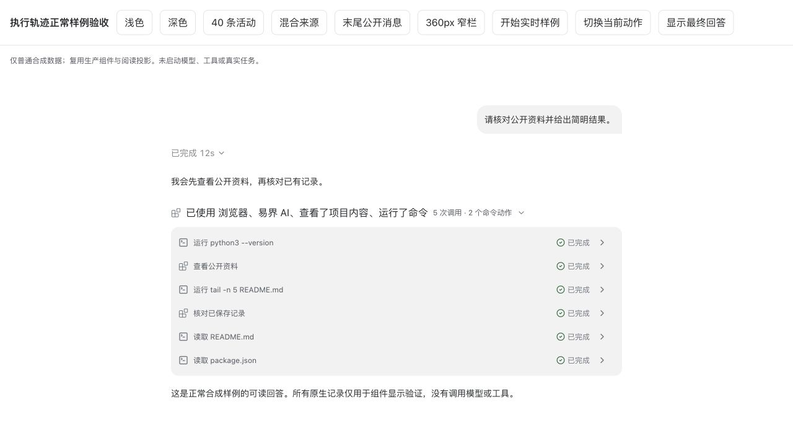
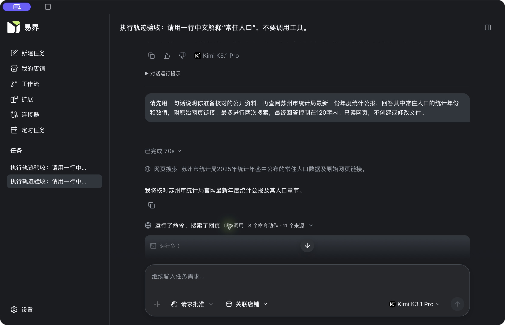

# FEAT-167 复审修复交付

2026-11-04。本轮完成执行轨迹展示修复与 v2 A01–A26 的逐项核验，继续复用固定 yijie-codex，不包含 diff。当前交付是本机开发实现；正式发布、签名和独立人工评审门禁没有改成通过。

修复重点是把原生事实、展示行、连续活动组及当前状态分开。72 条正常原生记录保留为 72 条事实，普通展开列表显示其中 40 条工具活动；一个命令可有多条动作行，但调用数仍只计一次。命令预览和工具标题来自经过安全投影的原生信息，没有新增执行器、重试器或模型进度消息。

P1 的两条正常路径已修复：command_output_pending_final 不再使整轮失去实时资格，参数被隐藏的 MCP 也不再因此丢掉可信的 inProgress。真实流缺口、未知诊断和冷历史仍保持保守展示。已保存格式6中的该策略诊断仅在读取时正确解释，不回写或清除原事实。

末尾可读 commentary 使用独立的阅读候选标记保持可见，原始 phase 不升级为 final_answer。未知阶段的最后可读回答在运行中和终态都受到保护；仅有 reasoning 不构成把前一条公开消息折叠的充分条件。

## 模块与修改范围

| 模块 | 结果 | 位置 / 来源 |
|---|---|---|
| Runtime | 复用原有 Item、phase、commandActions、计划和 retry；源码/补丁未新增。 | yijie-codex@55b4e51049d6f4fc0af4b35f12832357f5e4ea06 |
| 契约 | 继续 Native6 / SSE13 / IPC6 / format6；没有新增 wire 字段或数据库迁移。 | Contracts dfd9012954c716d360f702d6be3bdbdef75e0633；consumer 符合性 |
| Host | 安全命令预览、相对路径按命令 cwd 解析、appContext/已知注册工具/允许的 js.title 与来源。 | internal/session/native_trace.go、native_conversation.go |
| Native | 普通输出等待不毒化整轮诊断；真实缺口不被清除；已有诊断由新阅读规则兼容解释。 | src-tauri/src/chat/native_conversation.rs |
| 存储/IPC | 保留现有事实、format6 和 revision；正常重开不改写已有 view_json；复用事务后发布。 | native_conversation_storage.rs、database.rs 验证、IPC6 |
| 事实视图 | 内容部分隐藏与可信运行状态分开；冷历史仍不激活。 | conversation-trace-liveness.ts、conversation-timeline.ts |
| 阅读投影 | ActivityEntry 与 Item 分离；推理过滤、命令动作拆行、稳定身份、阅读候选及头部状态。 | conversation-activity-entry/presentation/summary.ts |
| 组件 | 具体行预览、混合来源摘要、有界列表、单项组优化、通知显示折叠、尾部消息保持可读。 | ChatActivityGroup / ChatActivityRow / ChatTurnGroup / ChatTraceNotices |
| 交互状态 | 同 key 文本即时、跨 key 稳定化；保留用户选择与耗时行锚点；不持久化分组偏好。 | useActivitySummary.ts、chat-trace-presentation.store.ts |

`contract-impact = semantic` 是本次修复增量的分类。整个 FEAT-167 原先退役旧通道的 breaking 分类仍保留。现有源契约、生成形状和精确 pin 未改变；没有为了通过检查放宽 schema、更新假哈希或新增旧 V4/SSE11 读取。

## v2 的 26 项结果

“通过”表示右侧所列的适用行为与验证层次，不把离线状态样例说成真实模型运行。当前固定 fork 不提供 partial_answer 枚举；通用新问卷/动态工具执行接口没有在本轮新增。审批、普通可读交互消息和未知值降级按当前已接入能力核验。

| 编号 | 判定 | 核验行为 | 证据 |
|---|---|---|---|
| A01 | 通过 | 公开说明分段，普通推理不占工具行。 | ChatTraceV2Acceptance.test.ts · A01/A02；真实 Kimi/MiniMax 历史 |
| A02 | 通过 | 72 条原生事实保留；40 条工具活动、1 个连续组；reasoning 行为 0。 | 组件测试；浏览器实测 40 行、320px 容器 |
| A03 | 通过 | 相同查询、不同原生 ID 均保留；不按文本去重调用。 | A03；Native interleaved/deduplication |
| A04 | 通过 | started/delta/completed 更新同一 Item，最终快照替换草稿。 | native_final_replaces_delta_without_prefix_reconciliation；跨仓字节验证 |
| A05 | 通过 | 默认 all 保留公开说明；纯阅读层 latest 模式先分段再隐藏，不合并阶段。 | A05；当前产品默认 all |
| A06 | 通过（当前原生范围） | 未知阶段最后可读回答、末尾 commentary 阅读候选均外显，phase 不改。 | A06 两类边界及真实 unknown 历史；固定 fork 无 partial_answer 枚举，未新增该能力 |
| A07 | 通过 | 显式 final 后有已结束工具/网页/推理，正文仍可读。 | A07；ChatNativeStreaming |
| A08 | 通过 | 只有最新未关闭组承担当前状态；旧组详情仍保留并发未结束状态。 | A08 |
| A09 | 通过 | 工具结束后当前组头显示思考；只有推理时显示一个系统状态。 | A09/A25 |
| A10 | 通过 | 同 key 文字立即更新；key 切换按 1 秒窗口稳定；完成摘要立即替换。 | A10 虚拟时钟；真实组件实时样例 |
| A11 | 通过 | 空推理结束不改组键；单条命令补齐一个动作不重建行；用户展开保持。 | A11 两项；组内键盘/滚动观察 |
| A12 | 通过 | 显式最终正文开始且无用户选择时折叠过程；手动展开优先。 | A12；ChatActivityGroup |
| A13 | 通过（已选策略） | 当前挂载会话内保留选择，切上下文/重挂载清空，不承诺跨重启。 | A13；ChatTimeline 重排与选择测试 |
| A14 | 通过 | 中断保留已有消息和工具状态；未结束 Item 与计划不被标成功。 | A14；Native terminal/plan 正常状态样例 |
| A15 | 通过 | 失败、缺少退出码、成功空输出分别呈现；不以无输出推导成功。 | A15 |
| A16 | 通过（已接入交互） | 原生审批和决策瞬态外显；最后可读用户交互消息不被过程折叠。 | ChatTimeline/ChatTurnGroup 审批桥接与正文保持；未新增通用问卷式 requestUserInput 执行接口 |
| A17 | 通过 | 保留 retry true/false/unknown；连续等价提示仅在显示层折叠。 | A17；Host/Native retry intent 测试 |
| A18 | 通过（已知恢复窗口） | 传输序号去重、完成快照保护、正常重开及冷历史冲突选择均核验。 | 跨仓 SSE→Native→SQLCipher→重开→前端；不声称任意乱序的通用 exactly-once |
| A19 | 通过 | 冷历史的 inProgress 不冒充实时；普通输出策略/参数隐藏不误伤活跃状态。 | P1 四项测试；A19；真实历史无活动动画 |
| A20 | 通过 | 长列表有限高、末尾无空白；组内与页面可分别滚动；最小窗口可读。 | 浏览器 1180×760、360px 正文；实际 App 1180×760、100%/200% |
| A21 | 通过 | 按钮、展开语义、焦点和键盘滚动；系统减少动态效果时扫光为 none。 | PageDown/End/Shift+Tab/Return；axe 回归；reduced-motion.json 实测 |
| A22 | 通过 | 安全预览、原生路径/查询、可信标题；缺失诚实兜底，other 网页不冒称搜索。 | Host 普通样例、未变 v6 consumer conformance、A22 |
| A23 | 通过 | 计划独立呈现最新值，结束/中断不自动勾选未完成步骤。 | A14/A23；Native plan 与现有 ChatTurnPlan 测试 |
| A24 | 通过 | 多个动作引用父 Item，一次调用；展开只查看，不执行/批准/重放。 | A24；真实历史展开；跨仓 3 调用→4 展示行 |
| A25 | 通过 | 无 commentary 仍有当前状态/真实工具组；不生成假 assistant 进度。 | A09/A25；推理事实保留但不生成零调用组 |
| A26 | 通过（易界策略） | 失败、待审批和不完整记录保留在折叠外。 | A26；既有审批/不完整记录正常组件回归 |

## 实际验证

- 前端安全全套：259 个文件，2,101 项通过、16 项跳过；另 Node 脚本 27 项通过。
- Native 安全全套：默认配置 626 通过、14 ignored、27 filtered；日常 Kimi 配置 661 通过、16 ignored、27 filtered，均无失败。后续单元素测试风格修正保留全部断言并单独复验。
- Host：gofmt、go vet、脚本语法通过；NativeTrace / NativeProcess / FEAT132Native 的相关 session/app race 测试通过，最终预览缺省兜底另行定向通过。
- 跨仓实际生产代码：Host 序列化事件 → SSE decoder → NativeDisplayBuffer → SQLCipher 保存 → 正常重开 → 实际前端投影通过。3 个调用生成 4 条工具行，reasoning 原事实保留、不生成工具行；最终文本不做前缀拼接。
- 生成一致性、Frontend lint/类型检查、Rust fmt、两配置 clippy -D warnings、Vite build、设计文档 build 通过。构建保留既有 chunk 体积警告。
- 元仓文档治理：57 项测试通过，manifest / Contract First 校验、Shell 语法和 feature.yaml 校验通过。时序正文缺少四个已声明 ID 的初次失败已补齐链路说明后复验，正式门禁状态不变。
- 标准调试 .app 使用原 Homes，实际读回 Kimi、MiniMax 各两轮。检查了展开、最终回答、模型标识和历史静态状态；实机 1268×780 / 1180×760、100% / 200%、浅色 / 深色均观察。
- 组件浏览器长列表：40 行、0 条普通 reasoning 行、320px 容器、scrollHeight 1636、末尾 scrollTop=1316，最后一行底部与容器底部一致；360px 正文没有横向溢出。键盘返回标题并 Return 收起成功。
- 系统“减弱动态效果”从原 off 临时打开：实际媒体查询为 true，活跃头部 animationName=none。随后恢复 off；系统浅色、应用100%均已恢复，系统设置正常退出，临时浏览器页和预览服务已关闭。

日志与截图索引见 [evidence/repair/log-index.json](evidence/repair/log-index.json)、[UI 记录](evidence/repair/ui-verification.json) 和 [减少动态效果实测](evidence/repair/reduced-motion.json)。完整矩阵另存 [JSON](evidence/repair/acceptance-v2.json)。

## 数据保护

未执行清库、旧数据迁移、任务重放或新一轮模型任务。两个原 Runtime rollout 文件长度和 SHA-256 都与本轮验收前一致；task_started / task_complete 仍各为4。原2个会话、4轮正文、模型标签和耗时已在真实界面读回。恢复固定开发入口后再次核对，文件和计数仍一致，见 [最终数据核对](evidence/repair/restored-data-check.json)。

日常 SQLCipher 文件经历正常应用状态写入，文件指纹发生变化，不能把它说成全库逐字未变；本轮未改变数据库 schema 或执行删除/迁移。Native 正常读回测试另外比较读取前后的 view_json 与事实数量，确认读取不会回填或改写既有记录。证据见 [数据保护记录](evidence/repair-data-preservation.json)。

历史记录中从未保存过的完整命令/标题不会被猜测补造；它们采用安全旧标签或通用文案。新观察到的事件使用丰富安全预览。命令正文只取受限首行并脱敏、限长，路径或参数需要隐藏时保留明确说明，不无条件透传原始命令或 raw arguments。

## 修复后的补充边界

已结束单项活动可直接显示，已有用户展开选择不会因此丢失。多个动作共享父调用与输出；当前原生格式不足以证明等价的普通 MCP 不按工具名猜测二次合并。原生动态工具/新交互类型未在本轮扩充执行能力，沿原有诚实降级及专用产物链处理。

没有新增 MiniMax/Kimi 模型回合；前轮四次真实调用只用于本次历史读取验证。没有人为制造真实失败/重试/审批；这些行为使用正常状态样例和现有原生桥接回归。按用户长期安全条款，不执行强杀、可执行文件替换/劫持、权限破坏、恶意资源或攻击注入；被排除的测试不计为通过，见 Desktop scripts/test-safety-exclusions.json。Host 未运行包含这些禁止场景的无筛选全仓测试。

## 复核与交付状态

复核修正了原验收把“40次调用”当成“40条活动行”的口径，并补了正常命令输出策略、部分MCP内容、空推理组键、单动作身份、相对路径、工具标题、未知网页动作、当前组状态、耗时锚点和尾部 commentary 候选的可执行验证。

初跑失败日志未改成成功：过时的 reasoning 行断言已替换成事实保留与工具行数量的双重断言；原 draft 测试的单元素循环保持相同断言后通过 clippy；Host 输入变更触发标准入口拒绝后，通过原 canonical freeze 登记已验证本地候选并正常重建。契约验证保持严格，新增兼容测试放在 Desktop consumer，未修改 Contracts 源或依靠 dirty source 绕过 pin。

已正常退出调试版，重新通过 `pnpm client:dev` 启动固定开发入口，沿用原数据、完整功能与正常服务清理流程。源码改动保留在工作树；没有自动提交、推送、签名或生产部署。正式 production_hardened 门禁仍按 feature.yaml 的真实状态保留。

## 验收画面

以下第一张为生产组件的普通合成样例，不是真实模型调用；其后为原会话的实际应用界面。

