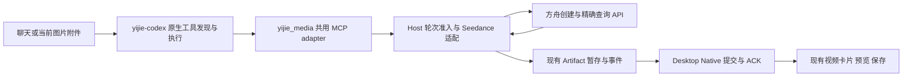

# FEAT-173 实施设计（修订2，已接受并实施）

当前实施状态：已按修订2及09补充落地并完成本机真实验收；结果、用量与保留限制见[12-real-acceptance.md](12-real-acceptance.md)。以下设计和历史审计约束继续保留。

2026-11-12深度复审修订。修订1保存在references/plan-revision-1.json；发现与源码依据见08。此为当时方案阶段记录，后续已授权实施。用户后续要求补齐对话流预览/播放/保存环节，同属修订2，详见[09交付接线补充](09-video-chat-delivery.md)。

## 1. 架构决定

采用**应用自动装配的MCP工具**，延续FEAT-172：



产品内置与MCP工具族是两个维度；Seedance是外部生成模型，不是聊天模型选项，也不是OpenAI hosted tool。不会把视频塞进原生image-generation扩展，不新增dynamic tool或独立MCP安装项。

共享进程、`/media/mcp`路由、两级内部token、官方rmcp协议与现有运行时配置。Host继续拥有供应商调用和Artifact准入。新增内容仅为视频provider适配与必要的异步任务归属记录，不能变成规划器、Agent执行事实库或通用任务平台。此增量是ADR-0025图片范围之外的扩展，见Proposed ADR-0026。

## 2. 两工具、原生等待与丢失句柄恢复

继续只增加两项业务MCP工具，不逐一包装四个供应商API：

| MCP工具 | 输入 | 行为 |
|---|---|---|
| `yijie_media.generate_video` | prompt、image_mode、image_indices | 当前根轮次校验与持久预占后只创建一次；返回可继续查询的操作引用 |
| `yijie_media.get_video_result` | 可选video_operation_id | 定位本聊天已有操作，有界查询原任务；交付前可取回，交付后只引用原Artifact；绝不创建供应商任务 |

`video_operation_id`直接复用创建时的已接受原生root turn ID，以`AgentSessionID + rootTurnID + video`归属；不额外生成UUID或建设生成ID服务。供应商task ID仍仅在Host内。

**无句柄也能恢复，但不猜任务：** get未带ID时先定位当前root已有视频记录，其次定位本聊天唯一未决视频，再次仅在本聊天总共只有一条视频记录时选该记录。无记录返回not_found；仍有歧义则只返回最多5条本聊天本地引用及创建时间/输入模式/最近已知阶段，要求指定ID，若记录更多明确标明列表不完整并可按原native历史中的ID查询。该分支不调用供应商、不自动选“最新”、不开放账户列表，也不新增list工具或UI。专家检查先于定位记录。

`generate_video`同root同摘要返回原引用，不同摘要冲突。**同聊天已有尚未交付的未决视频时，新root也不得再POST**：返回existing_operation及原引用，提示先恢复原任务；创建结果未知也占此名额。已明确供应商失败/过期/取消或不可继续的输入/格式/大小交付拒绝可以结束未决状态，原root的创建记录仍保留。首期不支持同聊天并发另起未决视频；确需独立生成，用户使用已有“新建任务”入口，不提供force/retry/换模型绕过开关。不同已完成需求不能仅因prompt相同被错误合并。已进入Artifact交付的处理见第6节，不能把原任务继续查询变成新生成。

创建请求上限30s；取结果单次桥接总预算120s，包含锁/下载槽位等待、5s原生binding等待、GET和下载，外层继续使用145s bridge与150s MCP配置。GET间隔至少10s且429尊重Retry-After，单次GET15s，下载60s是最大超时，均从同一剩余预算扣除（不要求必须剩满60s）；预算不足/正被另一调用观察时返回pending，不另开第二轮轮询或下载。不改供应商execution_expires_after。

150s是**当前配置值，不是yijie-codex的能力上限**。原生支持配置tool timeout与Code Mode exec/wait；选两工具是为处理供应商异步身份、响应丢失和重开，并非原生不能长等待。可在同一原生cell中依次await创建与取结果，cell yield后用原生wait继续；不要让Host生成聊天回合或轮询LLM。pending的MCP isError=false；next_action只是供模型原生后续调用的业务提示，不是Runtime自动执行的命令，也不能保证模型永不提前结束。自然回合结束、停止和模型预算耗尽均按有限恢复边界处理。

保留Kimi原生tool_search与MiniMax现有namespace适配、原生hook/审批/日志；在已有enabled_tools中加入两项，精确工具approve而非全局approve，专家审批不变。创建readOnlyHint=false/idempotentHint=false；取结果因可能暂存交付，readOnlyHint=false/idempotentHint=true，服务器并行标志仍false。源码证实readOnlyHint=true会让原生允许并行，即使server标志false，因此不能把取结果误标纯只读。幂等hint不替代Host同操作预占/交付检查。当前rmcp-client仅对特定tools/list错误自动重试，不能声称原生会替业务tools/call重试或恢复方舟任务。

现有`yijie_artifacts.get_artifact_status`保持只读当前Host代的Artifact事实；不加供应商轮询、视频专用ACK恢复或持久状态分支。

## 3. 输入、固定模型与默认值

用户已确认文生视频＋图片生视频。工具接受非空prompt（建议上限4000 Unicode字符）、必填image_mode与索引数组。图片索引从1开始，按本轮`ContentBlockImage`顺序；Host校验并取出已接受附件，模型不能传URL、路径、base64、供应商ID或Key。图片分析/仅写视频脚本不得触发创建。历史生成图片必须重新作为当前轮次附件提供；首期不从旧消息URL、任意路径或已经清空的Host spool猜取参考图。

| image_mode | 索引规则 | 供应商content |
|---|---|---|
| `none` | 空数组 | 文本 |
| `first_frame` | 恰好1个当前图片索引 | 文本＋首帧图片 |
| `first_last_frames` | 有序2个当前图片索引 | 第一项首帧、第二项尾帧；允许[1,1]引用同一张图；不得混入参考图 |
| `reference_images` | 1至本轮实际图片数，最多10；不重复 | 全部标为参考图片 |

图像格式取现有附件与Seedance支持的交集：PNG/JPEG/WebP/GIF；沿用当前每附件10MiB、每消息最多10附件等更严格上限，同时在创建前验证供应商尺寸/比例及实际JSON请求体上限。不能按供应商30张能力擅自扩建附件协议；不静默缩放、截断、丢图或裁剪。图片条件、支持模型、默认值的官方事实集中见06。同一图片用于首尾帧时复用同一索引，不要求用户重复上传；角色由输入场景决定，不属于输出参数定制。

仅由Host构造：

```json
{"model":"doubao-seedance-2-5-260628","content":[{"type":"text","text":"用户的视频描述"}]}
```

图片场景只在content增加受管图片和对应角色。所有供应商可选生成参数保持省略，不能照抄带duration/ratio/watermark的官方演示代码；也不继承Seedream的Size或Watermark字段。不暴露model、resolution、ratio、duration、frames、generate_audio、seed、watermark、output_format、draft、service_tier、execution_expires_after、priority、tools等可调项，不加callback_url，不启用额外联网搜索。工具描述禁止拼接`--参数`弱校验后缀；适配层发现明确控制后缀时在POST前拒绝，不能让模型通过prompt绕过默认参数策略。自然语言内容描述保留，不重写成参数。

## 4. 专家隔离与当前轮次准入

任意显式专家都沿用原有绑定、资源资格、选集与审批；不新增视频专家白名单、preflight、fallback协调器或专家协议。现有LinkFox专家的模型、素材与收费规则不被Seedance默认值替代。

Runtime排除整个内置媒体server；Host在创建、每个后续GET、下载开始和交付前复核当前持久expertBinding及pending selection。已选专家、选集变更未完成、资格失败均拒绝新内置动作，保留选择；旧native历史的工具定义与旧操作引用也不能绕过。新恢复root不能继承创建时“当时未选专家”的许可。

复用现有专家binding revision、StateIdle/ActiveTurnID、根轮次cancel context与5s绑定等待。专家变更本来要求Idle且无活动轮次，不另造专家锁/授权快照。等待操作锁/槽位后重新校验；最终派单/发布准入与匹配轮次收尾使用同一既有边界，不在检查和派发间使用过时的record。已经在选择前发出的HTTP不能被“归零”，只能停止本地等待和后续发布；验收的0调用指选择生效后没有新的POST/GET/下载，不伪造撤销既有请求的事实。

图片和视频各有创建名额；共享根轮次/附件/取消上下文，不让一个called位互相占用。恢复查询绑定**当前观察轮次**，创建root仅用于任务身份：停止旧创建轮次不能取消新查询轮次，停止当前查询必须立即停止其观察与迟到交付。计划草案、非Host拥有的根线程、未绑定/非活动轮次及会话清理均不派单。

已提交本地视频的预览/保存与现有Artifact ACK重试属于既有本地交付链，不是内置供应商调用，可以继续；该例外不授权读取供应商任务或下载URL。只有用户显式移除/改变专家后的新合法root可重新取回未交付的内置任务。

## 5. 最小任务记录与一次创建

只在现有bbolt新增私有`video_operations_v1`，一条记录对应一个已有原生root。原生MCP管理执行/cell，既有TurnOperation管理用户提交；它们都不保存Seedance task ID和有无发出POST的事实，因此这条业务归属记录必要。不得扩为第二套Agent状态库。

保留字段：record version、所属session/创建root/thread、输入模式与参数摘要、提交阶段、供应商ID（若已知）、最近明确供应商状态/观察时间，以及一次Artifact交付标记（artifact ID、delivery turn ID）。不保存ACK回执、manifest/内容副本、prompt全文、图片base64、Key、签名URL或原始供应商错误。每次观察更新同一有界记录，不写逐次轮询日志或事件流水。

移除修订1的独立8天TTL/1024条配额/清理体系；记录跟随原聊天生命周期，清理复用原session cleanup并级联此bucket。远端ID/URL过期只影响能否查询/下载，不删除防重记录后自动解除限制。供应商无记录时返回not_found/expired而非重建。单聊天未决名额检查与新记录预占必须在同一本地事务中，跨会话不共用操作或结果。

创建顺序：

1. 原生当前根轮次、专家状态、输入校验通过；重复/已有未决先返回，不读取Key也不POST。实际新创建才取原运营凭据。
2. 用已有root ID记录预占；写失败则0POST。派发前检查取消与原生有效状态。仅当确认尚未发送时，可记录cancelled_before_submit并释放未决名额；一旦可能发送，不能按失败回滚预占。
3. 供应商创建只发一次。获得task ID后先持久保存再向MCP返回；原生响应/桥接返回丢失后，get无句柄分支仍能找回这一记录。
4. 已可能发出POST但无明确ID，或ID保存失败：outcome_unknown；不重POST、不调用账户列表猜ID。正常重开只校验记录，将无完整提交回执的残留视为unknown，不发任何网络请求。
5. 创建结束、查询GET、下载、轮次取消是不同阶段；本地停止不写provider cancelled。已解码的迟到task ID只可更新仍存在且归属未撤销的原记录，不能重新插入已清理会话，也不能为等待它继续网络工作或发布成功。

bucket自带record version，原会话record和顶层store格式不变。源码只显示bbolt允许独立bucket，旧writer/清理保留性仍是实施时的定向兼容条件，不能预先写成已证明。新reader遇未知/冲突记录只禁用视频写入，不丢记录、不重POST。回滚优先仅禁用视频；不以清库解决新旧版本问题。

## 6. 交付边界：复用Artifact，不新建ACK恢复

**供应商任务可恢复 ≠ Host暂存可跨重启恢复。** 当前Artifact Store启动会清旧spool，ACK tombstone只在内存；Native会重发pending ACK，但新Host没有原entry时仍返回not_found。Native已failed/cancelled的Artifact也不允许重新开始传输。修订1的“持久化视频ACK、恢复manifest、重建同ID spool”会改变这些既有语义，现全部删除。

视频工具仅负责首次生产者交付，之后交给原链路：

1. 供应商成功后在当前合法观察root下载并验证MP4；这个阶段不发布Artifact started。停止/普通网络失败时可在以后重新查询/下载**原task ID**，不重新创建。
2. 下载只接收官方依据支持的精确HTTPS域、无重定向，单独请求不携带Ark Authorization；URL不写MCP/SSE/日志/任务记录。64MiB单产物、256MiB/会话、1GiB spool保持；最多2个视频下载占内存，槽位等待计入120s总预算。超限/格式不符报告交付拒绝，不改默认参数、转码或重生成。
3. 复用正常spool暂存；可给该操作预留一个Artifact ID，尚未发布时的同Host重试只能核验/复用自己的暂存，不能删除同会话其它产物。首次发送started之前，按当前有效root持久写入`handoff_attempted + artifact_id + delivery_turn_id`。标记失败则不发事件；调用与停止用现有短发布锁裁决，不持锁做网络。
4. 标记之后只允许本次调用按原started/completed或失败流程交付。**即使标记后尚未发事件就退出，也不由后续调用猜测并重放。** 这是避免重复卡片的保守边界，不能把handoff_attempted解释为已发布或已提交。
5. 后续get遇到交付标记，先查原Artifact当前事实，不访问供应商、不再下载、不重发started/completed、不换ID/turn；不会新造视频专用ACK、恢复接口或修改get_artifact_status。

| 观察到的既有事实 | 返回与展示 |
|---|---|
| 同Host Store确认committed | 可返回committed，引用同一Artifact |
| 同Host仍staged | 只说明暂存，按原get_artifact_status核验；反复仍未确认时报告交付未确认，不重复投递 |
| Store expired或明确发布失败 | 报告相应已有失败/过期，保留原身份，不复活终态 |
| Host已重启/entry缺失/发布结果不确定 | 返回delivery_unconfirmed，携带原Artifact引用供核对已有对话；不把unknown写成failed或committed，不重建spool |
| Native本地已ready但Host ACK未知 | 现有UI仍能播放/保存；模型只报告Host提交确认不可得，不能否定Native事实 |

现有Native pending ACK继续原逻辑；是否重试成功取决于当前Host原entry是否仍在，不能把“客户端会重试”宣传为“服务端能恢复”。没有新Desktop状态机、IPC、SQL migration、通用补领平台或ACK镜像。临界处没有交付的视频可能无法自动补领，这个限制与现有Artifact边界一致；只允许明确报告未确认，不能为了掩盖它再POST或伪造成功。

MP4容器/多轨音频由既有Native校验和WebKit处理，复用视频卡片、Range、保存与释放。默认有声保持，不加封面要求或return_last_frame，不再调用生图。真实播放/体积仍需独立验收，不能由代码审计代替。

### 6.1 对话流内可见、可播、可保存的必做接线

[09](09-video-chat-delivery.md)为本节的具体实施与验收约束：

- Seedance的succeeded必须转成真实MP4 bytes、Host暂存和原provider/video事件；不能只返回任务ID或URL。started/completed必须在当前媒体turn.completed之前发布成功，之后才返回MCP staged，不能交给脱离轮次的后台goroutine。
- 事件绑定当前查询/交付的原生turn，而非创建root；由原Native decoder完成到本地session/turn的映射。默认媒体订阅实际为schema9，文件/文档profile为12，复用现有选择逻辑。
- Native原下载/校验/SQLCipher提交后，artifact_changed须同时驱动ArtifactProjection和artifact_reference刷新，进入ChatPage→ChatArtifactList→ChatArtifactShell→ChatArtifactVideo。无助手正文、正文迟到、新轮次取回及切换聊天都必须可见且不重复。
- Native本地ready即能显示播放器、播放和保存，ACK pending不是额外展示禁令；Host committed仅表示已观察到ACK。预览打开/解码/实际播放仍分别验证，不把ready或ftyp当播放成功。
- 复用三个现有Native视频command、本地Range协议和原生保存面板；ready时自动加载预览metadata，用户点击播放，不添加自动有声播放、封面生成、外链播放器或供应商URL访问。
- 已确认需要最小修改ChatArtifactShell的provider/video失败文案，避免将交付失败写成“生成失败，请重新提交”。预览重新加载/保存重试仅使用既有本地产物，不新建视频。

不改变第2版的一次handoff与恢复边界；必要的现有通知/索引/组件接线修正属于本期，若涉及新协议、Native状态机或ACK恢复仍须先修订相应设计。


## 7. 停止、恢复与远端取消

停止入口仍是已有InterruptTurn/原生turn interrupt与匹配轮次收尾。Host取消其当前观察context，不只依赖HTTP断线或MCP cancellation通知。每个GET、重试delay、锁/槽位等待、下载和发布前都检查同一context；不新增自动恢复worker或后台轮询。

| 停止/退出时点 | 持久事实与后续恢复 | 新创建 |
|---|---|---|
| 确认POST尚未发出 | cancelled_before_submit；当前操作结束 | 当前root不重发；新用户需求可另开root |
| POST可能已发送但无task ID | outcome_unknown；get可找回本地记录并报告，无账户列表对账 | 本聊天未决屏障禁止再POST；独立需求使用新建任务 |
| task ID已保存、排队/运行中 | 停止本地观察；下次合法root查同ID | 禁止 |
| 已生成、下载尚未交付 | 停止下载，原task可再次查询/下载 | 禁止 |
| handoff_attempted之后 | 按第6节核对原Artifact；不保证跨Host补领 | 查询/预览/重试不得创建 |
| Artifact已提交 | 保留成功与本地内容，旧停止不得追加失败终态 | 不重复原需求；新的独立需求按原提交入口处理 |
| 已选专家/选择变更未完成 | 阻断新的内置创建、查询和下载；已提交本地内容可读 | 禁止内置兜底 |

正常回合结束/模型预算耗尽同样停止本次观察；不会自动取消供应商任务。新root查询必须创建自己的观察context，不能复用已经cancel的创建root context。旧终态只匹配当时的root；任务记录本身不能被当成一个永久活跃turn。

保持首期**不自动DELETE、不提供供应商任务管理工具**。官方接口queued可取消、running不支持、终态DELETE会删记录；先GET再DELETE仍无法排除状态变化竞态。把Stop接到DELETE既不等于强取消，也可能删除结果，不能以HTTP200或本地cancelled承诺远端撤销/退款。

没有task ID、查询失败、URL失效、Native交付未知各有明确终态/可继续路径，均不成为重POST许可。工具说明和真实自然语言验收必须覆盖“停止后继续”“刚才的视频呢”“网络错误重试”，而不只是手工给定正确操作ID的回环。

## 8. 凭据与装配

直接将现有`ArkCredential(HostHome)`解析器注入新SeedanceClient。保留service=`com.yijie.ai.seedream`与SHA256(canonical HostHome) account，不为名称好看而迁移/复制Key。Key只在Host请求供应商时使用；MCP token与bridge token继续是独立的内部凭据。

同一Key不证明运营账号已开通Seedance或有足够余额。实现验收前由运营侧完成模型资格；普通用户不承担安装/授权步骤。普通调用禁止Keychain交互，资格缺失返回服务不可用。新Host构建如改变系统身份，用已有运营CLI在本人授权后复核，不新增产品Key设置页。本次没有读取或验证真实Key，也不继承FEAT-172的模型调用额度。

日常构建自动包含视频工具；可保留开发/回滚用video开关，正常产品入口无需用户启用。关闭只排除新视频工具并停止当前等待，保留图片、数据和兼容reader。无需变更共享AdapterStartup或添加token：adapter发现能力由同源构建提供，Host按配置设置enabled_tools，服务端准入再次检查。

## 9. 取舍与首期边界

| 方案 | 决定 |
|---|---|
| 单个长MCP调用 | 原生支持提高timeout，但进程重开/响应丢失仍需要持久供应商身份；不能仅靠延长timeout实现恢复 |
| 两工具＋已有root ID映射＋一次交付标记 | 推荐；原生负责执行与等待，Host只补一次创建/归属/首次交付，恢复前后边界明确 |
| 视频专用ACK持久化、manifest恢复、跨Host重建spool | 删除；这会扩成另一套Artifact恢复，现有需求不应顺带改ACK和Native终态语义 |
| 公网平台/队列/Webhook/独立配额清理系统 | 排除；本机范围没有这些必要性 |

输入、准确模型、全部默认值、同运营Key、专家不兜底及现有展示不变。新增明确产品限制为：同聊天未决视频先恢复原操作，不同时另起；需要独立新生成可用现有新建任务入口。Artifact交付后的Host重启不承诺自动补领。方案应作为这组明确边界整体接受，不能只接受“恢复”二字后在实现时偷偷扩大。

实施依赖和验收见05/02，修订依据见08。没有新增实现、付费、Git或公开发布授权。

实施复审修正：观察预算耗尽不覆盖刚收到的供应商终态，也不冒充用户停止；查询/下载的Retry-After即使与本地结束同时到达也保留。首期不承诺原视频编辑/延长或精确输出参数控制。详见[13](13-implementation-reaudit.md)。
